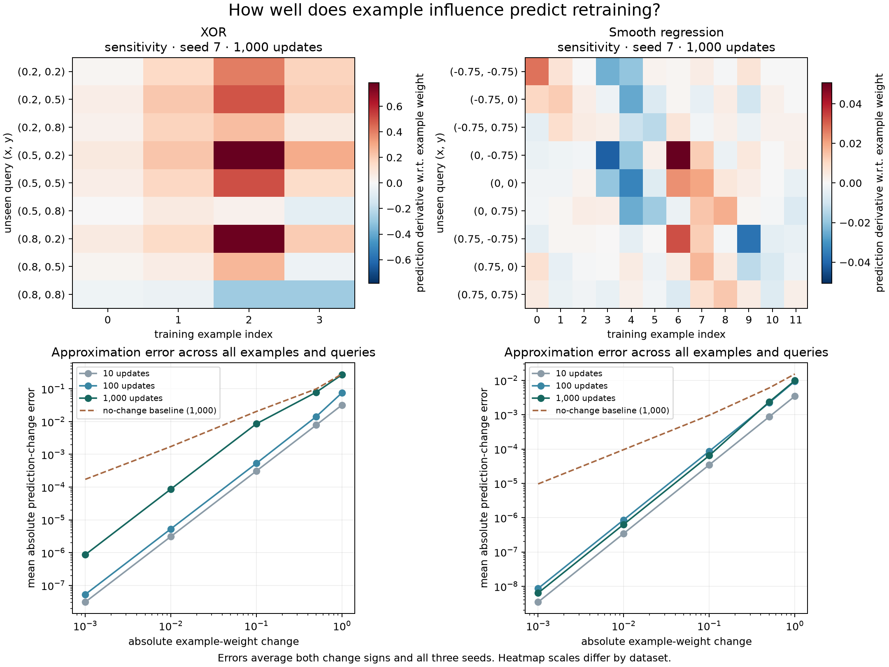

# Results

The heatmaps show how each training example affects each unseen query prediction.
Positive values mean that increasing the example's weight raises the prediction;
negative values mean it lowers it. They show seed 7 after 1,000 updates, with a
separate color scale for each dataset.

The error curves average over every training example, all nine unseen queries,
both signs of each weight change, and seeds 0, 7 and 19. The dashed baseline
predicts no change. This helps distinguish a useful estimate from a small error
caused by a small effect.

## What the experiment shows

At 1,000 updates:

| Dataset | Absolute weight change | Mean error | Maximum error | No-change mean error |
| --- | ---: | ---: | ---: | ---: |
| XOR | 0.001 | 8.68e-7 | 5.53e-6 | 1.73e-4 |
| XOR | 0.1 | 8.58e-3 | 5.48e-2 | 2.04e-2 |
| XOR | 1 | 0.270 | 1.214 | 0.283 |
| Regression | 0.001 | 6.37e-9 | 1.13e-7 | 9.61e-6 |
| Regression | 0.1 | 6.46e-5 | 1.43e-3 | 9.67e-4 |
| Regression | 1 | 9.86e-3 | 0.354 | 1.54e-2 |

For weight changes of ±0.001, the influence estimate's mean error is about 0.50%
of the no-change baseline error on XOR and 0.066% on regression. At ±1, those
ratios rise to 95.4% and 64.2%. The estimate helps with small perturbations,
but loses much of its advantage for large changes.

The largest error occurs on XOR, seed 0, after 1,000 updates. Setting training
example 2's weight to zero changes the prediction at `(0.8, 0.2)` by -1.296;
the estimate is only -0.083. An accurate local derivative does not guarantee
an accurate prediction for removing an example's contribution.

## Setup

Both tasks use the same two-hidden-neuron tanh network with a linear output,
half-squared-error loss, and full-batch gradient descent at learning rate 0.1.
All example weights start at 1. The loss denominator stays equal to the original
training-set size, including when an example's weight becomes zero.

XOR uses its four corner inputs. Smooth regression uses 12 grid points with targets
`sin(1.5*x) * cos(0.5*y) + 0.25*x*y`. Each task has nine query points absent from
its training data. [datasets.py](../datasets.py) defines the coordinates and
training-example order.

The sweep uses 10, 100 and 1,000 updates; seeds 0, 7 and 19; and weight changes
0, ±0.001, ±0.01, ±0.1, ±0.5 and ±1. This gives 3,564 XOR comparisons and 10,692
regression comparisons. Every perturbed model starts from the same initialization
as its baseline. [summary.csv](summary.csv) includes every training length and
nonzero change magnitude, with means and maxima.

These experiments measure prediction changes, not test accuracy. They cover two
small synthetic tasks and do not establish scalability or performance on
real-world data. Absolute errors also depend on the task's output scale.

Run `python3 experiment.py`, then `python3 plot.py` with the plotting dependencies
installed, to regenerate the CSV files and figure. The numerical experiment and
tests need only Python's standard library.
